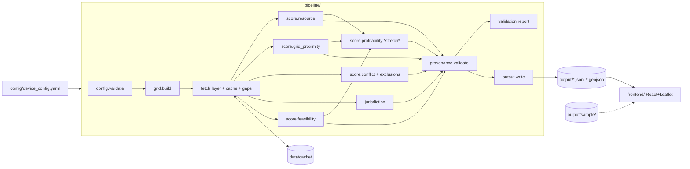

# Design Document: MA Tidal Buoy Siting Model

## Overview

The system is a batch Python Pipeline that writes static files, plus a static React + Leaflet Frontend that reads them. There is no runtime server. The Pipeline does all fetching, geometry work, and per-cell Component_Score computation. The Frontend recombines the Overall_Score from adjustable weights. It also re-derives the device-dependent values (capacity factors, energy, Resource, Profitability) from raw inputs stored in the Static_Output.



Core vs stretch, matching the requirements:

| Area | Scope |
|---|---|
| Grid, fetch/cache/gap layer, provenance, Resource (stream + rise/fall + wave context), Grid Proximity, Conflict + Hard_Exclusions, Jurisdiction, validation report, Overall_Score, map, table, top-5 panels, Device_Config display | Core |
| Feasibility depth + wave + port sub-scores | Core (cheap, reuses fetched data) |
| Feasibility slope sub-score (Req 9.2) | Stretch refinement |
| Profitability (Req 10), price fetch, cost multipliers | Stretch |
| CFRF fishbot / HAB Hub conflict layers (Req 7.7) | Stretch |
| Top-5 sentiment notes (Req 14.7-14.8) | Stretch |
| Frontend Device_Config editing + recompute (Req 12.3-12.5) | Core for Overall weights; device-value recompute is core for Resource, stretch for Profitability |

### Team split (4 people)

| Track | Owner | Modules |
|---|---|---|
| A. Scoring backend | Person 1 | `pipeline/config.py`, `grid.py`, `fetch/`, `score/resource.py`, `score/feasibility.py`, `score/profitability.py`, `provenance.py`, `validation.py`, `output.py` |
| B. Frontend | Person 2 | `frontend/` in full, built against `output/sample/` from hour 1 |
| C. Grid proximity + conflict data | Person 3 | `sources/hifld.py`, `sources/marinecadastre.py`, `sources/neodp.py`, `sources/emolt.py`, `score/grid_proximity.py`, `score/conflict.py`, `jurisdiction.py` |
| D. Writeup / video | Person 4 | `README.md`, `docs/schema.md` review, `output/sample/` hand-authoring (first task, unblocks B), sentiment notes (stretch), demo video |

The contract between tracks is the Static_Output schema (below) and the `Factor` shape. Track B never imports Python. Track C delivers functions that return `FactorResult` objects (defined below), and Track A owns how those are assembled.

## Architecture

### Repository layout (Req 16.1)

```
pipeline/            Python package + tests
  siting/
    config.py        load + validate Device_Config
    grid.py          grid generation + land mask
    fetch/
      client.py      HTTP with timeout/retry
      cache.py       data/cache/ keyed store
      gaps.py        DataGap model + registry
    sources/         one module per upstream source (pure parse fns + fetch wrappers)
      necofs.py doppio.py mom6.py coops.py ndbc.py hifld.py marinecadastre.py
      neodp.py emolt.py census.py massgis.py ports.py eia.py bathy.py
    score/
      ramps.py       shared linear ramp + weighted-mean helpers (pure)
      resource.py grid_proximity.py conflict.py feasibility.py profitability.py
    jurisdiction.py
    provenance.py    Factor model + output validator
    validation.py    known-site check
    output.py        writers
    run.py           CLI entry: `python -m siting.run`
  tests/
frontend/            Vite + React + TS + react-leaflet
  src/
    data/load.ts     fetch + type-guard Static_Output
    model/           pure TS: overall.ts, resource.ts, profitability.ts, sort.ts, bins.ts, config.ts
    components/      MapView, RankedTable, CellPanel, TopFive, WeightSliders, DeviceConfigPanel, ProvenanceLegend
  tests/
config/device_config.yaml
data/cache/          gitignored
output/              Static_Output (real run); output/sample/ committed
docs/schema.md
```

`.gitignore` covers `data/cache/*`, `.env`, `*.key`, `node_modules/`, `__pycache__/` (Req 16.6).

Commands:
- Pipeline: `cd pipeline && pip install -e .[dev] && python -m siting.run --config ../config/device_config.yaml --out ../output`
- Frontend: `cd frontend && npm install && npm run dev` (reads `VITE_DATA_DIR`, default `/output`, set to `/output/sample` for sample mode)
- Tests: `pytest` in `pipeline/`; `npx vitest --run` in `frontend/`

### Pipeline run order

1. `config.validate()`. Stops on invalid Cell_Size or outer extent before any fetch (Req 1.3).
2. `grid.build()`. Fetches the shoreline. A failure with no cache stops the run (Req 1.5).
3. Source fetches. Each returns data or a `DataGap`. The run never aborts here (Req 2.6).
4. Per-cell scoring by component modules.
5. `provenance.validate(cells)`. Any factor missing a tag or citation aborts the write (Req 3.8).
6. `validation.report()`. Then write all files atomically: write to `output/.tmp/`, then rename. A failed run leaves the old output untouched (Req 1.3, 1.5, 3.8).
7. Print the gap summary grouped by source (Req 2.8).

## Components and Interfaces

### Config (`config.py`)

```python
@dataclass(frozen=True)
class DeviceConfig:
    cell_size_mi: float = 1.0            # [0.25, 5]
    outer_extent_nm: float = 12.0        # [3, 200] (min 3 per Req 1.1)
    rated_power_kw: float = 100
    rotor_diameter_m: float = 5
    power_coefficient: float = 0.40      # (0,1]
    pad_area_m2: float = 50
    conversion_efficiency: float = 0.30  # (0,1]
    tidal_cycles_per_year: float = 705.8
    seawater_density: float = 1025
    velocity_source_priority: tuple = ("NECOFS_FVCOM", "DOPPIO", "MOM6", "NOAA_CURRENTS")
    min_power_density_wm2: float = 500
    min_depth_m: float = 5
    min_qualifying_area_km2: float = 0.5
    baseline_credit: float = 40
    benchmark_velocity_ms: float = 2.5
    max_station_distance_km: float = 25
    max_buoy_distance_km: float = 100
    min_range_m: float = 1.0
    max_range_m: float = 3.0
    grid_full_km: float = 1; grid_zero_km: float = 30
    grid_weights: dict = {"transmission": 0.5, "substation": 0.5}
    fish_zero_km: float = 5
    conflict_weights: dict | None = None  # None = equal
    depth_bands: dict = {"seabed": (15, 35), "buoy": (5, 15)}
    feasibility: dict  # slope (5,15) deg, wave (1,3) m, port (10,50) km
    profitability: dict  # slopes per km / per m, baseline_annual_cost_usd
    hard_exclusion_layers: list[str]

def load(path) -> DeviceConfig            # raises ConfigError(param, accepted_range)
```

Seawater-density and power-coefficient defaults are recorded in the config with a comment citing the source of each assumption. The frontend gets the same keys through `metadata.json`.

### Grid (`grid.py`)

- Projection: all geometry work runs in EPSG:26919 (NAD83 / UTM 19N, meters). Output is reprojected to EPSG:4326.
- Fixed origin: `(x0, y0) = (230000, 4540000)` in UTM 19N. This lies SW of Nantucket and covers RI→NH. Cell `(i, j)` has its lower-left corner at `(x0 + i·s, y0 + j·s)` with `s = cell_size_mi × 1609.344`. Cell id = `f"C{s_m:.0f}-{i:04d}-{j:04d}"`. That gives deterministic ids (Req 1.7).
- Extent: MA land (Census cartographic boundary) buffered by `outer_extent_nm × 1852` m, minus land, clipped at the MA/RI and MA/NH land-boundary junctions extended seaward: water west of the MA/RI junction meridian and north of the MA/NH junction parallel is dropped (the NH junction faces east, so a meridian would not separate MA and NH waters). Junctions come from the shared land border in the shoreline data. A cell is generated if its centroid lies inside the water extent (Req 1.1, 1.4).
- `build(cfg, shoreline) -> GeoDataFrame[cell_id, i, j, geometry_utm, centroid_lat, centroid_lon]`. Lat/lon are rounded to 6 dp (Req 1.6).

### Fetch layer (`fetch/`)

```python
class FetchClient:
    def get(self, source: str, url: str, params: dict, parse: Callable[[bytes], T]) -> T | DataGap
```

- Cache key = `sha256(source + url + canonical_json(params))`. Files go in `data/cache/{source}/{key}.bin` with a `{key}.meta.json` holding the fetch date, URL, and params (Req 2.2).
- Cache hit with readable meta and successful `parse` → return the parsed result with no network call (Req 2.3). A parse exception deletes both files and fetches live (Req 2.4).
- Live fetch: `requests` with `timeout=60`, up to 3 attempts total, backoff of 2s and 4s (Req 2.5). Status ≥400, timeout, or connection error counts as a failed attempt.
- Results: an empty body, zero features, or an all-NaN array → `DataGap(source, "empty response")`. Three failed attempts → `DataGap(source, "fetch failure")`. A successful parse with no coverage at a cell → `DataGap(source, "no coverage")`, raised per cell by the scorer.
- OPeNDAP (xarray) goes through the same retry wrapper (`open_dataset` + `.sel(...).load()`). Subset arrays are cached as netCDF bytes.
- `GapRegistry.add(cell_id | "*", factor, source, reason)`. `summary()` returns `{source: count}`.

### Provenance (`provenance.py`)

```python
Tag = Literal["QUANTIFIED DATA", "PROXY", "EXTERNAL ADDITION"]

@dataclass
class Citation:
    agency: str; dataset: str; endpoint: str
    date: str            # YYYY-MM-DD; model run date or fetch date
    date_kind: Literal["model_run", "fetch"]
    note: str | None = None   # e.g. "modeled current", "not blended"

@dataclass
class Factor:
    name: str
    value: float | str | None
    unit: str | None
    tags: list[Tag]           # exactly one of QUANTIFIED DATA|PROXY, optionally + EXTERNAL ADDITION
    citation: Citation
    gap: DataGap | None       # value is None iff gap is not None
    label: str | None = None  # "modeled current", "distribution interconnection below 5 MW", ...

def validate(cells) -> list[ProvenanceError]   # empty list required before write
```

Validator rules (Req 3.1-3.3, 3.8):
- `tags` has exactly one primary tag.
- The citation's agency, dataset, and endpoint are non-empty, and `date` matches `^\d{4}-\d{2}-\d{2}$`.
- Factor `velocity_*` has `label == "modeled current"` and a citation dataset in {NECOFS FVCOM, Doppio, MOM6}, with `date_kind == "model_run"`. NOAA current predictions are the exception: they are labeled "predicted current (harmonic)", tagged QUANTIFIED DATA, and carry a separate rule.
- `value is None` ⇔ `gap is not None`.

Kit-equivalent sources (no EXTERNAL ADDITION tag): NECOFS, Doppio, MOM6, CO-OPS, NDBC, HIFLD transmission/substations, the utility-by-town layer, diadromous fish stations, NE Ocean Data Portal layers, eMOLT. All others get EXTERNAL ADDITION.

### Score helpers (`score/ramps.py`, mirrored in `frontend/src/model/ramps.ts`)

```python
def ramp(x, x0, x1, y0=0.0, y1=100.0) -> float
    # y0 at x<=x0, y1 at x>=x1, linear between; works for x0>x1 (descending ramps)
def weighted_mean_available(scores: dict[str, float|None], weights: dict[str,float]) -> float|None
    # mean over non-null with renormalized weights; None if none available or weight sum 0
```

Every distance, slope, wave, and fish sub-score uses `ramp`. Every component aggregate uses `weighted_mean_available`. Results are rounded to 1 dp at write time only.

### Resource (`score/resource.py`) — Core

Tidal stream (Req 4):
- `velocity_series(cell) -> (source, t_start, t_end, speeds_ms[])`. Sources are tried in `velocity_source_priority`. NECOFS gives depth-averaged `ua`, `va` at the nearest element centroid to the cell centroid. Doppio/MOM6 give `ubar`, `vbar` at the nearest rho point. NOAA predictions come from the nearest current station within 5 km. Speed = √(u²+v²).
- `power_density = 0.5 * rho * v_peak**3`.
- `qualifying_area`: cells passing the power-density and depth thresholds are flood-filled over edge-adjacent cells. Each cell's area counts toward the group total. Groups with an area ≤ threshold get sub-score 0 with `failed_threshold="area"`.
- Sub-score: if any threshold fails → 0 with the reason. Otherwise `ramp(P, P_min, P_bench, baseline_credit, 100)`, with `P_bench = 0.5·rho·v_bench³`.
- CF: `mean(min(0.5·rho·A·Cp·v_t³, P_rated_W) / P_rated_W)`, clamped to [0,1]. Energy = `rated_kw·CF·8760`. When the sub-score is 0 → energy 0 with reason "below EPRI thresholds" (Req 4.7).

Rise/fall (Req 5.1-5.4, 5.9):
- Nearest CO-OPS station by haversine, from the stations with harcon available. Mean range is MN from `datums.json` (MHW−MLW). Harcon is fetched and stored as the supporting record (M2 amplitude) per the steering. If the station is beyond `max_station_distance_km`, or harcon is empty → gap.
- `E_cycle_J = 0.5·rho·9.81·pad_area·R²`. Sub-score = `ramp(R², R_min², R_max², 0, 100)`.
- CF = `(E_cycle_J/3.6e6 · eta · cycles) / (rated_kw·8760)`, clamped. Energy = `rated_kw·CF·8760`.

Wave context (Req 5.6): nearest NDBC station within `max_buoy_distance_km`. Uses the mean of `WVHT` and `DPD` over the realtime2 45-day record, with missing values (`MM`) dropped. `P_wave_kWm = rho·g²/(64π)·H²·T / 1000`. Stored as a factor with `note="not blended"` and excluded from Resource.

Resource = `max(non-null stream, rise_fall)`, with `resource_path ∈ {"tidal_stream","rise_fall"}` (ties go to tidal_stream). If both are null → null with a gap (Req 5.7-5.8).

Known limitation, surfaced in metadata: the NECOFS forecast window is about 3-5 days. A run during neaps understates the peak, and the CF is computed only over that window. The Pipeline records `t_start`/`t_end` and prefers a hindcast archive month when one is reachable.

### Grid Proximity (`score/grid_proximity.py`) — Core (Track C)

- HIFLD transmission lines (`returnGeometry=true`) and substations, queried by an envelope = grid bbox + 50 km (Req 6.1). Paginated with `resultOffset` until `exceededTransferLimit` is false.
- Distances are computed in UTM with an `STRtree` nearest query, in km rounded to 0.01 (Req 6.2).
- Utility: the territory polygon containing the centroid, or else the nearest one. Label "distribution interconnection below 5 MW", tagged PROXY (Req 6.3).
- Each sub-score = `ramp(d, full_km, zero_km, 100, 0)`. Component = `weighted_mean_available` (Req 6.4-6.6).

### Conflict + Hard_Exclusions (`score/conflict.py`) — Core (Track C)

- Exclusion layers come from the config key `hard_exclusion_layers`. Defaults: `protected_habitat` (MPA Inventory no-take/no-access + MA NHESP Priority Habitat), `residential_shoreline` (MassGIS Land Use residential polygons + DCR/MassGIS public beaches), `shipping_lanes`, `cable_areas`. Exclusion = `cell_polygon.intersects(any layer geometry)`, recording every triggering layer (Req 7.1).
- Design note: North Atlantic right whale critical habitat covers almost all of Cape Cod Bay. It is a graded Conflict sub-score (`whale_critical_habitat`), not a hard exclusion, so the Cape Cod Bay rise/fall result stays visible. This choice is documented in the README.
- If a layer fetch fails or returns empty → gap, no exclusion from that layer, and every cell gets `exclusion_check_incomplete: [layer]` (Req 7.3).
- Graded sub-scores (0 = no conflict). Each is tagged and computed with `ramp`:
  - `vessel_traffic`: AIS transit density at the centroid, percentile-normalized → PROXY
  - `fishing_activity`: eMOLT observation count within 5 km, percentile-normalized → PROXY
  - `diadromous_fish`: `ramp(d_km, 0, fish_zero_km, 100, 0)` → PROXY. Never an exclusion trigger (Req 7.5).
  - `whale_critical_habitat`: 100 when intersecting, else 0 → QUANTIFIED DATA + EXTERNAL ADDITION
  - Stretch: `cfrf_fishbot`, `hab_events` → EXTERNAL ADDITION (Req 7.7)
- Component = `weighted_mean_available(subs, conflict_weights or equal)`. All null → null with a gap (Req 7.4, 7.6).

### Jurisdiction (`jurisdiction.py`) — Core (Track C)

- Source: NOAA MarineCadastre US State Submerged Lands polygon (MA). A centroid within or on the polygon → `{"jurisdiction": "state", "agency": "MA CZM"}`. Otherwise → `{"jurisdiction": "federal", "agency": "BOEM"}` (Req 8.1). `covers()` is used so the boundary counts as state.
- Straddle: the cell polygon crosses the polygon boundary → `straddles_boundary: true` (Req 8.3).
- The boundary line is written to `output/boundary_3nm.geojson` for the map toggle.
- Jurisdiction is not an input to any score function. It is enforced structurally because the score functions do not receive it (Req 8.2).
- Disclaimer: every jurisdiction or regulatory field written carries `disclaimer: "Not legal advice"`, and the frontend renders it next to the field (Req 8.5).

### Feasibility (`score/feasibility.py`) — Core (slope is stretch)

- Depth: NECOFS `h` at the nearest node is the primary source. NOAA NCEI Coastal Relief Model (ERDDAP griddap) is the fallback, and is also the slope source. `depth_score(d, band) = 100 inside [lo, hi]`, else `ramp(distance_outside, 0, 10, 100, 0)`. Scored per device type, and the feasibility path uses the device matching `resource_path` (tidal_stream → seabed, rise_fall → buoy) (Req 9.1).
- Slope (stretch): max gradient over the CRM 3×3 neighborhood in degrees, `ramp(s, 5, 15, 100, 0)`.
- Wave exposure: `ramp(H_mean, 1, 3, 100, 0)`, from the same NDBC fetch as wave context.
- Port distance: nearest principal port, `ramp(d, 10, 50, 100, 0)`.
- Component = equal-weight `weighted_mean_available`. `feasibility_omitted: [names]` is listed (Req 9.5-9.6).

### Profitability (`score/profitability.py`) — Stretch

- Price: EIA v2 `electricity/retail-sales`, state MA, sector ALL, latest 12 months averaged, ¢/kWh → USD/kWh. The citation records the period. The API key comes from the `EIA_API_KEY` env var. A missing key → gap "fetch failure: no API key" (Req 10.1, 10.5).
- `gross = max(E_stream, E_rf) × price`. `device_path` is recorded.
- Multipliers: `m_transport = 1 + k_t·port_km`, `m_transmission = 1 + k_g·min(trans_km, sub_km)`, `m_maint = 1 + k_mp·port_km + k_mw·H_mean`. All have k ≥ 0, so each multiplier is ≥ 1. Tagged PROXY (Req 10.2).
- `net = gross − baseline_cost × m_t × m_g × m_m` (Req 10.3).
- Score = min-max normalized over non-excluded cells with non-null net. If all values are equal → 50 (Req 10.4).

### Validation (`validation.py`) — Core

The 5 sites are hard-coded per Req 15.1. Each site is matched to the cell with the nearest centroid by haversine, over all cells including excluded ones. If the match is farther than 3 mi → "not evaluated". The percentile uses the site's path sub-score: `pct = 100 × (count of cells with value ≤ v) / n` over cells with a non-null value on that path. Status is `pass` when pct ≥ 75, else `validation failure`. A gap value → "not evaluated" with the reason (Req 15.2-15.6).

### Frontend (`frontend/src/`) — Core

Pure model modules (all unit- and property-tested, no React):

```ts
// model/overall.ts
export const DEFAULT_WEIGHTS = { resource: .30, profitability: .25, feasibility: .15, grid: .15, conflict: .15 };
export function overall(c: ComponentScores, w: Weights): { score: number; partial: boolean; missing: ComponentName[] }
// positive = Σ_avail w_i s_i × (Σ_all w_i / Σ_avail w_i)  (0 if Σ_avail = 0)
// result = clamp(positive − (conflict==null ? 0 : w_c·conflict), 0, 100); excluded → 0

// model/sort.ts
export function rankRows(rows, key, dir): Row[]   // nulls last both directions; tie → cell_id asc
export function topN(rows, n=5): Row[]

// model/bins.ts
export function binIndex(score: number|null): 0|1|2|3|4|"gap"
export function radiusPx(score: number|null): number   // 4 + 8·s/100; null → 4

// model/resource.ts, model/profitability.ts — TS ports of CF/energy/sub-score/min-max
// model/config.ts — validateEdit(key, raw): {ok:true,value}|{ok:false,msg}
```

- State lives in one `useReducer`: `{data, weights, deviceCfg, activeLayer, selectedCellId, sort, showBoundary}`. Derived rows come from `useMemo` over `(data, weights, deviceCfg)`. 5,000 cells × O(1) work plus a sort runs well under 1 s (Req 11.3). A vitest benchmark asserts < 1000 ms.
- Components: `MapView` (react-leaflet `CircleMarker` with a canvas renderer, `fitBounds` to non-excluded centroids, a legend, a layer radio group, a boundary toggle defaulting off), `RankedTable`, `CellPanel`, `TopFive`, `WeightSliders` (step 0.05), `DeviceConfigPanel` (Cell_Size read-only with "re-run Pipeline to change"; reset button), `ProvenanceLegend` (one row per distinct factor name).
- Gap rendering: one `<FactorValue>` component renders `null` as `Data gap — {source}: {reason}`. No numeric fallback exists in the code path (Req 2.9).
- Accessibility: sliders and inputs have `<label>`s. Table headers are `<button>`s with `aria-sort`. Bin colors use a colorblind-safe sequential palette (viridis 5-step), and the gap color is gray `#9e9e9e`. Score text appears in the tooltip and panel, so color is never the only channel.

## Data Models

### Static_Output files (`output/`), documented in `docs/schema.md`

| File | Content |
|---|---|
| `metadata.json` | run info, config, citations, gap summary |
| `cells.geojson` | FeatureCollection, one Feature per Cell (polygon), properties = `CellRecord` |
| `timeseries.json` | `{cell_id: {t0, dt_s, speeds_ms: number[]}}` per cell with velocity data (raw input for frontend CF recompute) |
| `boundary_3nm.geojson` | state/federal boundary line(s) |
| `validation.json` | validation report |
| `sentiment.json` | (stretch) `{cell_id: {note, citations[]}}` Tier 3 |

`metadata.json`:

```json
{
  "schema_version": "1.0",
  "run_timestamp_utc": "2025-01-01T14:03:22Z",
  "cell_size_mi": 1.0,
  "device_config": { "rated_power_kw": {"value": 100, "unit": "kW"}, "...": {} },
  "citations": [ {"id": "necofs-massbay", "agency": "UMass Dartmouth SMAST", "dataset": "NECOFS FVCOM MassBay forecast", "endpoint": "http://www.smast.umassd.edu:8080/thredds/dodsC/...", "date": "2025-01-01", "date_kind": "model_run"} ],
  "gap_summary": { "NDBC realtime2": 0, "EIA retail-sales": 1 },
  "factors": [ {"name": "velocity_peak", "tags": ["QUANTIFIED DATA"], "citation_id": "necofs-massbay", "unit": "m/s"} ],
  "tier3_notice": "Public sentiment and local law are narrative only and are not scored.",
  "disclaimer": "Not legal advice",
  "known_limitations": ["NECOFS forecast window 2025-01-01..2025-01-05 may not include spring tide"]
}
```

`CellRecord` (properties of each feature; numbers in SI unless noted):

```ts
interface CellRecord {
  cell_id: string; i: number; j: number;
  centroid_lat: number; centroid_lon: number;          // 6 dp
  hard_exclusion: boolean; exclusion_layers: string[];
  exclusion_check_incomplete: string[];                 // missing layer names
  jurisdiction: "state" | "federal" | null; agency: "MA CZM" | "BOEM" | null;
  straddles_boundary: boolean; disclaimer: "Not legal advice";
  resource_path: "tidal_stream" | "rise_fall" | null;
  scores: {                                             // 0-100, 1 dp, or null
    resource: number|null; profitability: number|null; feasibility: number|null;
    grid: number|null; conflict: number|null;
    tidal_stream_sub: number|null; rise_fall_sub: number|null;
  };
  overall_default: number;                              // pipeline-computed with default weights (0 if excluded)
  factors: Record<string, Factor>;                      // see below
  feasibility_omitted: string[];
  stream_threshold_failed: ("power_density"|"depth"|"area")[];
  energy_reason: string | null;                         // "below EPRI thresholds"
  gaps: DataGap[];
}
interface Factor {
  value: number | string | null; unit: string | null;
  tags: ("QUANTIFIED DATA"|"PROXY"|"EXTERNAL ADDITION")[];
  citation_id: string; label?: string; note?: string;
  gap?: DataGap;
}
interface DataGap { factor: string; source: string; reason: "fetch failure"|"empty response"|"no coverage"; detail?: string }
```

Factor keys (closed set; the legend has one row per key): `velocity_peak`, `velocity_source_period`, `power_density`, `depth`, `qualifying_area`, `cf_stream`, `energy_stream_kwh`, `tidal_range`, `coops_station`, `energy_cycle_j`, `cf_rise_fall`, `energy_rise_fall_kwh`, `wave_power`, `wave_hs_mean`, `dist_transmission_km`, `dist_substation_km`, `utility`, `vessel_traffic`, `fishing_activity`, `diadromous_fish_km`, `whale_critical_habitat`, `slope_deg`, `port_km`, `price_usd_kwh`, `gross_usd`, `m_transport`, `m_transmission`, `m_maint`, `net_usd`.

Factors that are stretch or not computed are absent rather than null. The frontend treats an absent component as missing (Req 11.4, 14.5).

`validation.json`: `[{site, ref_lat, ref_lon, path, matched_cell_id|null, distance_mi|null, resource_percentile|null, status: "pass"|"validation failure"|"not evaluated", reason|null}]`.

`output/sample/` holds the same files for a hand-built set of 12 cells: 2 Hard_Exclusion cells, one velocity gap, one Profitability-absent variant, and one straddling cell (Req 16.5). A pytest check validates sample and real output against the same schema with `jsonschema`, generated from `docs/schema.md`'s companion `docs/schema/*.schema.json`.

### Live endpoints per source

All endpoints are resolved and smoke-tested in the first hour. Any endpoint that fails is swapped for the listed fallback, and the README source list is updated. Final URLs live in `pipeline/siting/sources/endpoints.py`.

| Factor | Source (agency) | Endpoint | Tier/Tag |
|---|---|---|---|
| Shoreline / land mask | US Census Bureau, Cartographic Boundary 1:500k states | `https://www2.census.gov/geo/tiger/GENZ2023/shp/cb_2023_us_state_500k.zip` (filter STATEFP 25, 33, 44) | QUANTIFIED DATA + EXTERNAL ADDITION |
| Velocity (primary) | UMass Dartmouth SMAST, NECOFS FVCOM | THREDDS OPeNDAP `http://www.smast.umassd.edu:8080/thredds/dodsC/FVCOM/NECOFS/Forecasts/NECOFS_FVCOM_OCEAN_MASSBAY_FORECAST.nc`; fallback `.../NECOFS_GOM3_FORECAST.nc` (vars `ua`,`va`,`h`, `lonc`,`latc`) | QUANTIFIED DATA, "modeled current" |
| Velocity (2nd) | Rutgers / NOAA, Doppio ROMS | `https://tds.marine.rutgers.edu/thredds/dodsC/roms/doppio/2017_da/his/History_Best` (`ubar`,`vbar`) | QUANTIFIED DATA, "modeled current" |
| Velocity (3rd) | NOAA GFDL / CEFI, MOM6 NWA12 | CEFI THREDDS/OPeNDAP NWA12 hindcast (resolve URL at build start; skip if unreachable) | QUANTIFIED DATA, "modeled current" |
| Velocity (4th) | NOAA CO-OPS current predictions | `https://api.tidesandcurrents.noaa.gov/api/prod/datagetter?product=currents_predictions&station={id}&interval=MAX_SLACK...` + station list `mdapi/prod/webapi/stations.json?type=currentpredictions` | QUANTIFIED DATA, "predicted current (harmonic)" |
| Tidal range / harcon | NOAA CO-OPS | stations `https://api.tidesandcurrents.noaa.gov/mdapi/prod/webapi/stations.json?type=harcon`; `.../stations/{id}/harcon.json`; `.../stations/{id}/datums.json` (MN) | QUANTIFIED DATA |
| Waves | NOAA NDBC | `https://www.ndbc.noaa.gov/data/realtime2/{STN}.txt`; station list `https://www.ndbc.noaa.gov/activestations.xml` | QUANTIFIED DATA |
| Transmission lines | HIFLD (DHS) via ArcGIS | `https://services1.arcgis.com/Hp6G80Pky0om7QvQ/arcgis/rest/services/Electric_Power_Transmission_Lines/FeatureServer/0/query?geometry={bbox}&geometryType=esriGeometryEnvelope&inSR=4326&outSR=4326&returnGeometry=true&outFields=*&f=geojson`; fallback mirror `https://services2.arcgis.com/FiaPA4ga0iQKduv3/arcgis/rest/services/US_Electric_Power_Transmission_Lines/FeatureServer/0/query` (HIFLD Open hosting changed in 2025; verify) | QUANTIFIED DATA |
| Substations | HIFLD via ArcGIS | `.../Electric_Substations/FeatureServer/0/query` same params; fallback: substation points derived from transmission line endpoints is NOT allowed (would fabricate) → Data_Gap | QUANTIFIED DATA |
| Utility territory | MassGIS, Electric Utility service areas by town | MassGIS ArcGIS REST `pubutil` layer (resolve layer at build start) | PROXY |
| 3 nm boundary | NOAA OCM MarineCadastre, US State Submerged Lands | `https://coast.noaa.gov/arcgis/rest/services/MarineCadastre/USStateSubmergedLands/MapServer/0/query`; fallback BOEM SLA boundary `https://gis.boem.gov/server/rest/services/BOEM_BSEE/MMC_Layers/FeatureServer/8` | QUANTIFIED DATA + EXTERNAL ADDITION |
| Shipping lanes | NOAA OCM MarineCadastre, Shipping Fairways/Lanes/Zones | `https://coast.noaa.gov/arcgis/rest/services/MarineCadastre/...ShippingFairwaysLanesZones` (InPort 39986) | PROXY + EXTERNAL ADDITION |
| Cable areas | NOAA OCM MarineCadastre, Submarine Cable Areas / NOAA ENC cables | MarineCadastre `SubmarineCableAreas` FeatureServer | PROXY + EXTERNAL ADDITION |
| Protected habitat | NOAA MPA Inventory; MA NHESP Priority Habitats (MassGIS) | MarineCadastre `MPAInventory`; MassGIS `NHESP Priority Habitats of Rare Species` | QUANTIFIED DATA + EXTERNAL ADDITION |
| Right whale critical habitat | NOAA Fisheries | NOAA Fisheries critical habitat ArcGIS service (North Atlantic right whale) | QUANTIFIED DATA + EXTERNAL ADDITION |
| Residential shoreline / beaches | MassGIS Land Use 2016; MassGIS/DCR public beaches | MassGIS ArcGIS REST | PROXY + EXTERNAL ADDITION |
| Vessel traffic | NE Ocean Data Portal / MarineCadastre AIS vessel transit counts | NE Ocean Data Portal ArcGIS (`services.northeastoceandata.org`) vessel density layer | PROXY |
| Diadromous fish stations | NE Ocean Data Portal (MA DMF river herring/diadromous fish) | NE Ocean Data Portal ArcGIS Fish → Diadromous layer | PROXY |
| Fishing activity | eMOLT (NOAA NEFSC / CFRF) ERDDAP | `https://erddap.emolt.net/erddap/tabledap/` eMOLT dataset `.csv?latitude,longitude,time&latitude>=..` | PROXY |
| Bathymetry / slope | NOAA NCEI Coastal Relief Model | ERDDAP griddap `https://coastwatch.pfeg.noaa.gov/erddap/griddap/usgsCeCrm1` | QUANTIFIED DATA + EXTERNAL ADDITION |
| Ports | USACE WCSC / BTS NTAD Principal Ports | `https://geo.dot.gov/server/rest/services/...NTAD...Ports...` (resolve at build start) | PROXY + EXTERNAL ADDITION |
| Electricity price (stretch) | US EIA API v2 | `https://api.eia.gov/v2/electricity/retail-sales/data/?api_key=$EIA_API_KEY&frequency=monthly&data[]=price&facets[stateid][]=MA&facets[sectorid][]=ALL` | EXTERNAL ADDITION + PROXY |
| CFRF fishbot (stretch) | CFRF ERDDAP | CFRF ERDDAP fishbot dataset | EXTERNAL ADDITION |
| HAB events (stretch) | NOAA HAB Hub / NCCOS | HAB Hub data service | EXTERNAL ADDITION |

The "resolve at build start" rows have known datasets but service paths that move often. Track C confirms them in hour 1. If a layer stays unresolved, the system degrades through the normal gap path (Req 7.3 incomplete flag) rather than blocking the run.

## Error Handling

| Condition | Behavior | Req |
|---|---|---|
| Invalid Cell_Size / outer extent | `ConfigError("cell_size_mi must be numeric in [0.25, 5]")`, exit code 2, no fetch, output untouched | 1.3 |
| Shoreline unavailable, no cache | `FatalSourceError("US Census cb_2023_us_state_500k", reason)`, exit 3, output untouched | 1.5 |
| Any other fetch failure / empty / no coverage | `DataGap` recorded, factor null, run continues | 2.6-2.7 |
| Corrupt cache entry | delete + live fetch | 2.4 |
| Timeout / HTTP error | 3 attempts total, then gap | 2.5 |
| Exclusion layer missing | no exclusion from that layer, all cells flagged incomplete | 7.3 |
| Boundary missing | jurisdiction null + gap; frontend "Data gap" | 8.4 |
| Price missing / no API key | Profitability null for all cells + gap | 10.5 |
| Provenance validation errors | list every `(cell_id, factor)`, exit 4, no write | 3.8 |
| Validation site out of range / gap | "not evaluated" + reason, run continues | 15.6 |
| Frontend: malformed Static_Output | type guard fails → error banner naming file + field; no partial render | — |
| Frontend: invalid config edit | reject, keep previous, inline error naming range | 12.4 |

No code path replaces a null with 0, a neighbor value, or a default. This is enforced by Property 3 and Property 4 below and by the `Factor` invariant `value is None ⇔ gap is not None`.

## Correctness Properties

*A property is a characteristic or behavior that should hold true across all valid executions of a system-essentially, a formal statement about what the system should do. Properties serve as the bridge between human-readable specifications and machine-verifiable correctness guarantees.*

### Property 1: Grid alignment and determinism

For any valid Cell_Size in [0.25, 5] mi and outer extent in [3, 200] nm, every generated cell is a square of edge Cell_Size whose lower-left corner is an integer multiple of Cell_Size from the fixed origin, and building the grid twice with the same inputs yields identical cell ids and centroid coordinates.

**Validates: Requirements 1.1, 1.6, 1.7**

### Property 2: Config validation gates the run

For any Cell_Size or outer extent value, the config validator accepts it if and only if it is numeric and inside its accepted range. For any rejected value, the error names the parameter and range, zero fetches are issued, and the output directory is byte-identical before and after.

**Validates: Requirements 1.2, 1.3**

### Property 3: Land mask exactness

For any synthetic land polygon set and grid, a cell is kept if and only if its centroid does not lie in land.

**Validates: Requirements 1.4**

### Property 4: Cache round trip and corruption recovery

For any source, URL, params, and non-empty payload, a fetch followed by a second identical fetch returns equal parsed data with exactly one network call. For any cache entry corrupted so that parsing fails, the next fetch performs exactly one live call and returns the live payload.

**Validates: Requirements 2.2, 2.3, 2.4**

### Property 5: Bounded retry

For any sequence of k consecutive transport failures followed by success, the client makes min(k+1, 3) attempts, returns data if k < 3, and returns a DataGap with reason "fetch failure" if k ≥ 3.

**Validates: Requirements 2.5**

### Property 6: Gaps are null, isolated, and counted

For any subset of sources forced to fail, every factor depending only on a failed source is null with a DataGap naming that source and a reason in {fetch failure, empty response, no coverage}. Every factor not depending on a failed source is non-null and equal to its value in an all-success run. The run's gap summary equals the count of DataGaps in the output grouped by source.

**Validates: Requirements 2.6, 2.7, 2.8**

### Property 7: Gap display never shows zero

For any Factor whose value is null with a DataGap, the frontend formatter output contains "Data gap", the source name, and the reason, and does not equal "0" or "0.0".

**Validates: Requirements 2.9, 8.4, 13.5**

### Property 8: Provenance completeness validator

For any output cell set, the provenance validator returns no errors if and only if every factor has exactly one primary tag, a citation with non-empty agency, dataset, and endpoint and an ISO date, `value is null ⇔ gap present`, and every model-velocity factor is labeled "modeled current" with a model name in {NECOFS FVCOM, Doppio, MOM6}. For any valid output with one tag or citation removed, the validator reports exactly that cell id and factor name, and the writer produces no files.

**Validates: Requirements 3.1, 3.2, 3.3, 3.8**

### Property 9: Non-scoring fields do not affect scores

For any cell, changing Tier 3 narrative text, Jurisdiction, agency, straddle flag, or wave power leaves every Component_Score and Overall_Score unchanged.

**Validates: Requirements 3.6, 3.7, 5.6, 5.7, 8.2**

### Property 10: Velocity source priority

For any priority order and any pattern of source availability per cell, the selected velocity source is the first available source in priority order, and if none is available velocity, power density, sub-score, CF, and energy are all null.

**Validates: Requirements 4.1, 4.2**

### Property 11: Cubic power density

For any velocity v ≥ 0 and scale k > 0, power_density(k·v) = k³ · power_density(v) within floating tolerance, and power_density(v) = 0.5 · ρ · v³.

**Validates: Requirements 4.3**

### Property 12: Tidal-stream sub-score thresholds and mapping

For any cell inputs, if power density ≤ P_min, depth ≤ D_min, or connected qualifying area ≤ A_min, the sub-score is 0 and the failing threshold is recorded. Otherwise the sub-score lies in [baseline_credit, 100], equals baseline_credit just above P_min (by continuity), equals 100 at or above P_bench, and is non-decreasing in power density.

**Validates: Requirements 4.4, 4.5, 4.7**

### Property 13: Capacity factor bounds and energy identity

For any non-negative speed series and valid device config, the tidal-stream CF lies in [0, 1] and equals the mean of per-step clipped power ÷ rated power. For any tidal range and valid config, the rise/fall CF lies in [0, 1]. For both paths, energy_kwh = rated_kw × CF × 8760.

**Validates: Requirements 4.6, 5.9**

### Property 14: Nearest station selection and range scoring

For any centroid and station set, the chosen CO-OPS station minimizes haversine distance; if that distance exceeds the max station distance, tidal range and rise/fall outputs are null with a gap. For any range R, E_cycle = 0.5·ρ·g·A·R², and the rise/fall sub-score is 0 for R ≤ R_min, 100 for R ≥ R_max, in [0, 100], and non-decreasing in R.

**Validates: Requirements 5.1, 5.2, 5.3, 5.4**

### Property 15: Resource is the max available path

For any pair of tidal-stream and rise/fall sub-scores (each possibly null), Resource equals the maximum of the non-null values with resource_path naming that path, or is null with a Resource gap when both are null.

**Validates: Requirements 5.7, 5.8**

### Property 16: Linear ramp correctness

For any x and thresholds x0 ≠ x1 with endpoint scores y0, y1, `ramp` returns y0 for x on the x0 side, y1 for x on the x1 side, a value between y0 and y1 otherwise, and is monotone in x. Python and TypeScript implementations agree on the same inputs.

**Validates: Requirements 6.4, 7.5, 9.1, 9.2, 9.3, 9.4**

### Property 17: Weighted mean of available sub-scores

For any map of sub-scores (some null) and non-negative weights, `weighted_mean_available` returns null when no non-null sub-score has positive weight, and otherwise returns a value between the minimum and maximum available sub-scores, equal to Σ w·s / Σ w over available entries, with omitted names listed.

**Validates: Requirements 6.5, 6.6, 7.4, 7.6, 9.5, 9.6**

### Property 18: Nearest distance correctness

For any centroid and non-empty set of line or point geometries, the reported distance is non-negative and equals the minimum over all geometries of the planar distance in km, rounded to 0.01.

**Validates: Requirements 6.2**

### Property 19: Hard exclusion by intersection

For any cell polygon and exclusion layer geometries, the cell is excluded if and only if the polygon intersects at least one geometry, `exclusion_layers` lists exactly the intersecting layers, and diadromous fish proximity alone never causes exclusion.

**Validates: Requirements 7.1, 7.5**

### Property 20: Jurisdiction by centroid

For any state-waters polygon and cell, jurisdiction is "state" with agency "MA CZM" if and only if the polygon covers the centroid, otherwise "federal" with "BOEM", and `straddles_boundary` is true if and only if the cell polygon crosses the polygon boundary.

**Validates: Requirements 8.1, 8.3**

### Property 21: Profitability normalization and multipliers

For any set of non-excluded cells with non-null net values, Profitability scores lie in [0, 100], the minimum net maps to 0 and the maximum to 100 (all equal → every cell 50), and ordering by score matches ordering by net value. For any non-negative distances and wave height, each cost multiplier is ≥ 1 and non-decreasing in its inputs.

**Validates: Requirements 10.1, 10.2, 10.4**

### Property 22: Overall score composition

For any component scores (each possibly null or absent) and weights in [0, 1], `overall` lies in [0, 100]. It equals clamp(Σ w_i s_i − w_c·conflict) when all components are present; equals clamp(Σ_avail w_i s_i × Σ_all w_i / Σ_avail w_i − w_c·conflict) when some positive components are missing (positive part 0 if Σ_avail = 0); omits the conflict term when conflict is null; is 0 for excluded cells; and `partial` is true exactly when some component is missing, with `missing` listing those names.

**Validates: Requirements 7.2, 11.1, 11.4, 11.5, 11.6**

### Property 23: Ranked visibility

For any cell set, the table rows and map markers both contain exactly the non-excluded cells, one each.

**Validates: Requirements 7.2, 13.1, 14.1**

### Property 24: Sorting and top-N

For any rows, sort key, and direction, the result is a permutation of the input, non-null values are ordered by the key in the requested direction with ties broken by cell id ascending, and every null value comes after every non-null value. `topN(rows, 5)` equals the first min(5, n) rows of the default Overall-descending ranking.

**Validates: Requirements 14.2, 14.3, 14.4, 14.6**

### Property 25: Marker bins and radius

For any score in [0, 100], `binIndex` returns the unique bin whose range contains it and `radiusPx` equals 4 + 8·score/100. For null, the bin is "gap" and the radius is 4.

**Validates: Requirements 13.2, 13.4, 13.5**

### Property 26: Device config edit validation and reset round trip

For any edit value, `validateEdit` accepts it if and only if it is numeric, > 0, and (for Cp and η) ≤ 1. For any sequence of accepted edits followed by reset, the config and every derived score equal the values loaded from the Static_Output.

**Validates: Requirements 12.4, 12.5**

### Property 27: Frontend recompute matches pipeline

For any cell fixture with raw inputs (speed series, tidal range, distances) and any valid device config, the TypeScript CF, energy, tidal-stream and rise/fall sub-scores, Resource, and Profitability equal the Python values for the same inputs within 1e-6.

**Validates: Requirements 12.3**

### Property 28: Validation site matching and status

For any grid and validation site, the matched cell minimizes centroid distance over all cells (including excluded ones), the percentile lies in [0, 100], and status is "validation failure" if and only if the percentile is below 75, or "not evaluated" when the nearest centroid is beyond 3 mi or the value is a gap.

**Validates: Requirements 15.2, 15.4, 15.5, 15.6**

## Testing Strategy

Property tests:
- Python: `hypothesis`, `@settings(max_examples=100)` minimum. TypeScript: `fast-check`, `{ numRuns: 100 }` minimum.
- Each test is tagged in its docstring or name: `Feature: ma-tidal-buoy-siting-model, Property {n}: {title}`.
- All PBT targets are pure functions. Network is replaced by a fake transport in Properties 4-6, and geometry tests use small synthetic shapely polygons.
- Property 27 uses a shared JSON fixture generator: hypothesis writes cases, and vitest reads `pipeline/tests/fixtures/cross_lang.json`, so both languages run the same cases.

Example / unit tests:
- Shoreline failure without cache (1.5)
- Metadata record contents (3.4)
- Rise/fall + stream both displayed (5.5)
- Utility label (6.3)
- Exclusion layer missing → incomplete flag (7.3)
- Boundary toggle default off (8.6)
- Disclaimer rendered next to jurisdiction in panel, row, and tooltip (8.5)
- Profitability absent → "Profitability not computed" (14.5)
- Tooltip and panel contents (13.7-13.8)
- Legend bins plus "Data gap" (13.3)
- Sentiment fallback text (14.8, stretch)

Smoke / integration:
- One live-endpoint smoke script `python -m siting.sources.smoke` hits each endpoint once with a tiny bbox and prints OK/GAP. It runs at hour 1 and before the final run. It is not part of CI.
- Grep test: no path in `pipeline/` references the kit zip (2.1).
- `sample/` and real output validate against `docs/schema/*.schema.json` (16.4-16.5).
- vitest benchmark: 5,000 synthetic cells, weight change → recompute + sort < 1000 ms (11.3).
- The validation report on the real run is reviewed manually against the 5 known sites (15.3).

Not tested automatically: visual styling, map fit aesthetics, README content (16.2-16.3), and the WCAG conformance of the UI. The design uses accessible defaults, but full validation needs manual assistive-technology testing.
